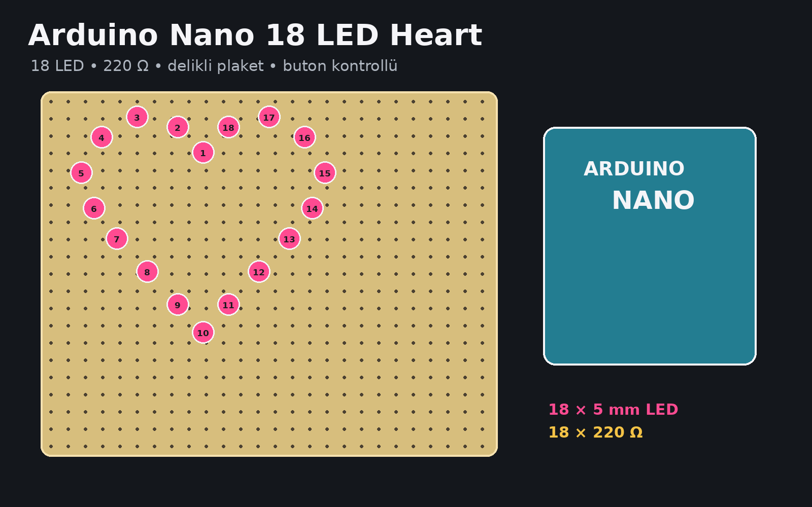
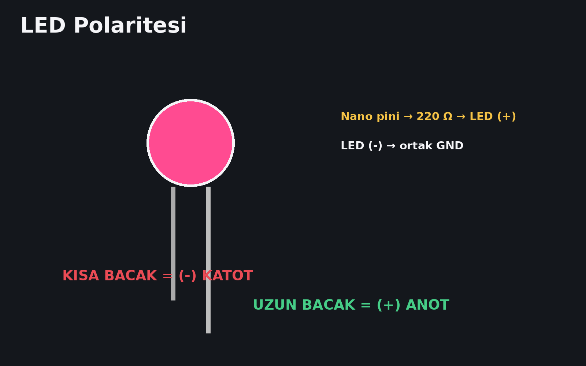
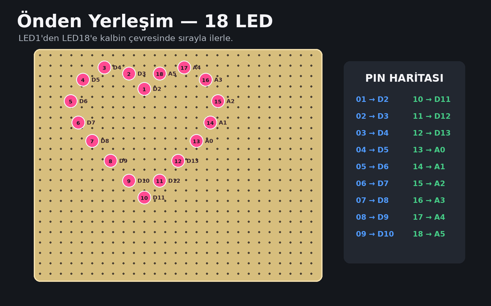
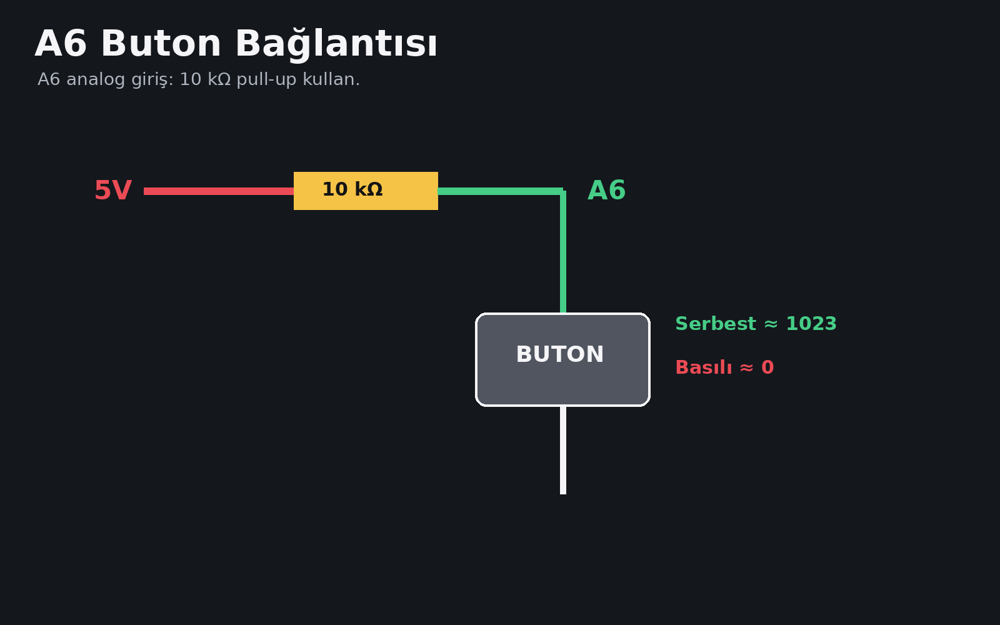
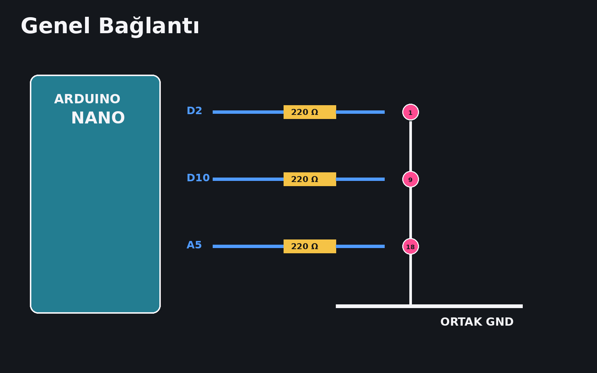
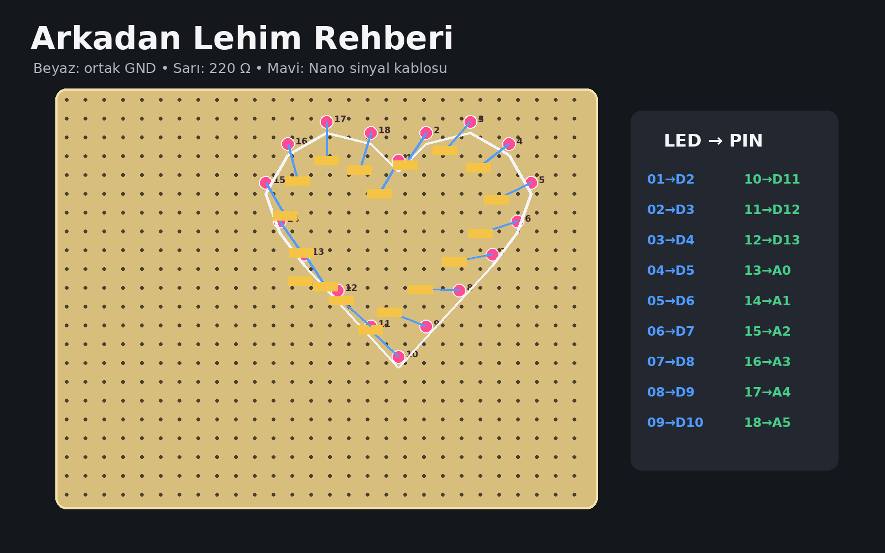

# Arduino Nano 18 LED Heart

Arduino Nano + 18 adet 5 mm LED ile delikli plaket üzerinde yapılmış kalp şeklinde LED projesi.



## Özellikler

- 18 LED bağımsız kontrol
- 6 animasyon + kapalı mod
- Tek butonla mod değiştirme
- Harici Arduino kütüphanesi gerektirmez
- LED test kodu
- A6 buton test kodu
- Türkçe lehim / yapım rehberi
- Görsel bağlantı şemaları

## Malzemeler

| Parça | Adet |
|---|---:|
| Arduino Nano V3 | 1 |
| 5 mm LED | 18 |
| 220 Ω direnç | 18 |
| 10 kΩ direnç | 1 |
| Anlık buton | 1 |
| Delikli plaket | 1 |

Tam liste: [`hardware/BOM.csv`](hardware/BOM.csv)

## LED bağlantısı

```text
Nano pini -> 220 Ω -> LED uzun bacak (+)
LED kısa bacak (-) -> ortak GND
```



## Pin haritası

| LED | Pin | LED | Pin |
|---:|:---:|---:|:---:|
| 1 | D2 | 10 | D11 |
| 2 | D3 | 11 | D12 |
| 3 | D4 | 12 | D13 |
| 4 | D5 | 13 | A0 |
| 5 | D6 | 14 | A1 |
| 6 | D7 | 15 | A2 |
| 7 | D8 | 16 | A3 |
| 8 | D9 | 17 | A4 |
| 9 | D10 | 18 | A5 |

> A6 ve A7 klasik Arduino Nano'da dijital çıkış değildir. A6 butonun analog girişi olarak kullanılır.



## Buton bağlantısı

```text
5V ---- 10 kΩ ----+---- A6
                  |
                BUTON
                  |
                 GND
```



## Kodlar

- Ana kod: [`firmware/led_heart_18/led_heart_18.ino`](firmware/led_heart_18/led_heart_18.ino)
- LED test: [`firmware/led_test_18/led_test_18.ino`](firmware/led_test_18/led_test_18.ino)
- Buton test: [`firmware/button_test_a6/button_test_a6.ino`](firmware/button_test_a6/button_test_a6.ino)

## Animasyonlar

1. Kapalı
2. Tek LED sırayla
3. İleri-geri
4. Karşılıklı iki LED
5. Rastgele parıldama
6. Kuyruk / comet
7. Kalp atışı

## Yapım

Detaylı rehber: [`docs/YAPIM_REHBERI_TR.md`](docs/YAPIM_REHBERI_TR.md)






## Arduino IDE

1. Kart Yöneticisi'nden **Arduino AVR Boards** yükle.
2. **Araçlar > Kart > Arduino AVR Boards > Arduino Nano**
3. **İşlemci > ATmega328P**
4. Yükleme olmazsa **ATmega328P (Old Bootloader)**
5. Doğru COM portunu seç.
6. Önce LED test kodunu yükle.
7. Sonra ana kodu yükle.

## Lisans

MIT
