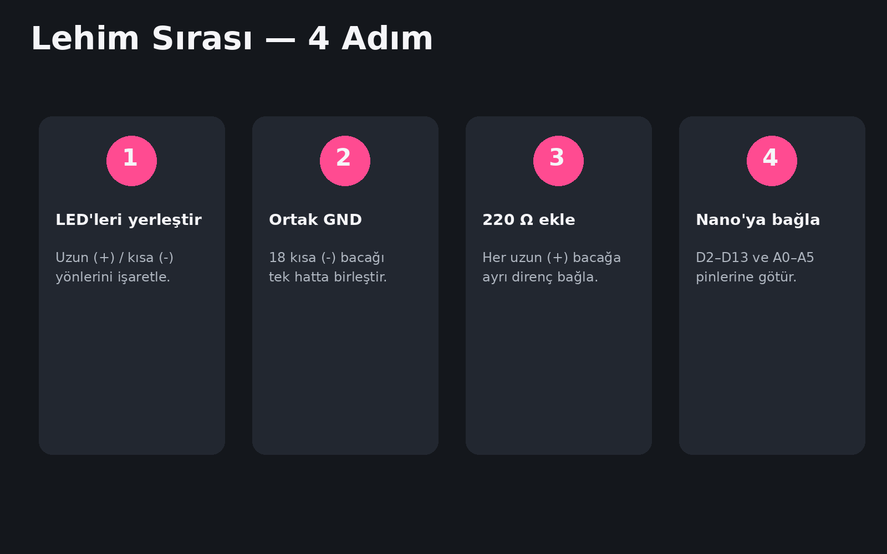

# A'dan Z'ye Yapım Rehberi

## 1. LED'leri yerleştir
18 LED'i kalp çevresine LED1 → LED18 sırası ile yerleştir.

## 2. Polarite
- Uzun bacak = (+) anot
- Kısa bacak = (-) katot
- Gövdedeki düz taraf genellikle (-)

## 3. Ortak GND
18 LED'in kısa (-) bacağını ortak bir GND hattında birleştir ve Nano GND'ye bağla.

## 4. 220 Ω dirençler
Her LED'in uzun (+) bacağına ayrı bir 220 Ω direnç bağla.

```text
Nano pini -> 220 Ω -> LED (+)
LED (-) -> GND
```

## 5. Nano pinleri

| LED | Pin |
|---:|:---:|
| 1 | D2 |
| 2 | D3 |
| 3 | D4 |
| 4 | D5 |
| 5 | D6 |
| 6 | D7 |
| 7 | D8 |
| 8 | D9 |
| 9 | D10 |
| 10 | D11 |
| 11 | D12 |
| 12 | D13 |
| 13 | A0 |
| 14 | A1 |
| 15 | A2 |
| 16 | A3 |
| 17 | A4 |
| 18 | A5 |

## 6. Buton
A6'ya şu şekilde bağla:

```text
5V -> 10 kΩ -> A6 -> BUTON -> GND
```

## 7. Enerji vermeden önce
- 5V ve GND kısa devre değil.
- LED artı hatları birbirine değmiyor.
- Ortak GND kesintisiz.
- Çapraz geçen çıplak teller temas etmiyor.

## 8. LED testi
Önce `firmware/led_test_18/led_test_18.ino` yükle.

## 9. Buton testi
`firmware/button_test_a6/button_test_a6.ino` yükle. Seri Monitör 9600 baud:
- Serbest ≈ 1023
- Basılı ≈ 0

## 10. Ana kod
`firmware/led_heart_18/led_heart_18.ino`


